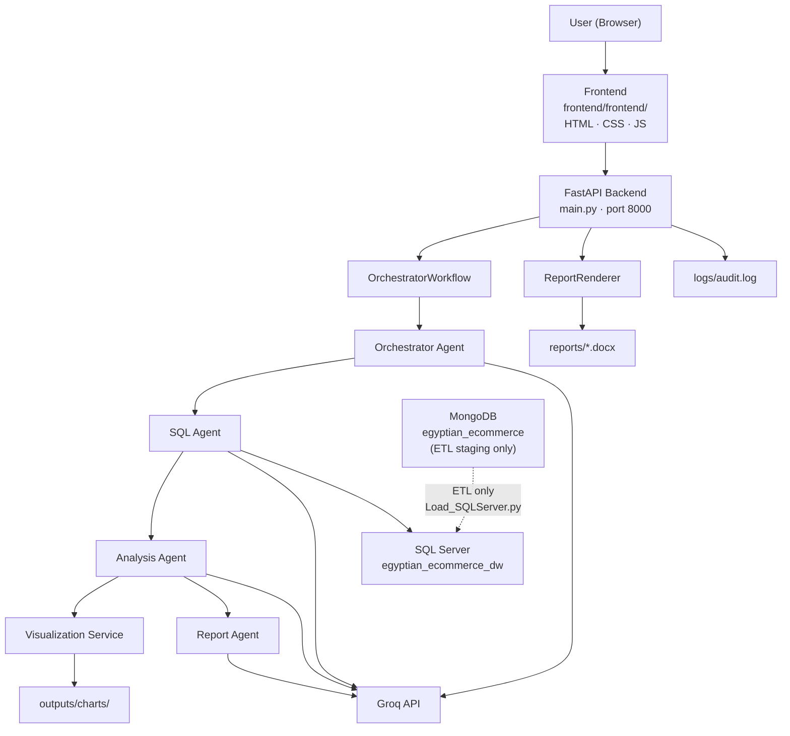

# Agentic-AI-FEDIS

Agentic-AI-FEDIS is an AI-powered data analysis platform built for an **Egyptian e-commerce** sample dataset. You submit a natural-language question through a web dashboard; the system plans the request, generates and runs **T-SQL** against a **SQL Server** data warehouse, analyzes the results with **Groq** LLMs, builds KPI dashboards and charts, and produces a downloadable **Word (`.docx`)** business report.

The stack is **Python-only**: a **FastAPI** backend orchestrates multiple specialized agents, and a **vanilla HTML/CSS/JavaScript** frontend is served from the same server. There is no separate Node.js frontend build step.

---

## Table of Contents

- [Features](#features)
- [Architecture](#architecture)
- [Project Structure](#project-structure)
- [Quick Setup](#quick-setup)
- [Run the Application](#run-the-application)
- [Environment Variables Reference](#environment-variables-reference)
- [API Endpoints](#api-endpoints)
- [Frontend](#frontend)
- [Data Model](#data-model)
- [Running Tests](#running-tests)
- [Troubleshooting](#troubleshooting)
- [Additional Documentation](#additional-documentation)

---

## Features

- **Natural-language analysis** — Ask business questions in plain English (or Arabic-friendly dataset context).
- **Multi-agent orchestration** — `OrchestratorWorkflow` coordinates Orchestrator → SQL → Analysis → Visualization → Report agents.
- **Text-to-SQL (T-SQL)** — The SQL agent inspects the SQL Server schema, generates T-SQL, executes it, and returns structured rows.
- **Automated business analysis** — Summaries, key findings, recommendations, and confidence scoring via the Analysis Agent.
- **Dashboard generation** — KPI cards and charts (matplotlib/plotly) produced by `VisualizationService`.
- **Report generation** — Structured Word reports (`.docx`) plus HTML preview via `ReportRenderer` and `python-docx`.
- **Web dashboard** — Submit queries, view KPIs/charts/insights, preview reports, and download `.docx` files.
- **REST API** — FastAPI endpoints for analysis, report download, and report history.
- **Groq LLM integration** — Primary model `openai/gpt-oss-120b` with automatic fallback to `openai/gpt-oss-20b` on rate limits.
- **ETL pipeline** — Optional but required for first-time setup: load sample CSV data into MongoDB, transform, and populate SQL Server.

---

## Architecture



### Component responsibilities

| Layer | Responsibility |
|-------|----------------|
| **Frontend** (`frontend/frontend/`) | Query input, results dashboard, report history, chart rendering (Plotly CDN), report download/preview. Calls same-origin API routes (`BASE_URL = ''`). |
| **FastAPI** (`main.py`) | HTTP API, static file serving, synchronous `/api/analyze` workflow execution, in-memory query store, report file delivery. |
| **Orchestrator Agent** | Converts the user question into a structured `TaskSpec` (intent, tables, analysis goals, visualization hints). |
| **SQL Agent** (`agents/sql_agent_python_only.py`) | Schema retrieval, LLM-based T-SQL generation, query execution via `SQLServerClient`. |
| **Analysis Agent** | Produces summaries, key findings, chart recommendations, and business recommendations from query results. |
| **Visualization Service** | Deterministic chart/KPI generation; writes PNGs to `outputs/charts/`. |
| **Report Agent + ReportRenderer** | LLM-structured report content rendered to HTML preview and `.docx` on disk. |
| **MongoDB** | Staging store for ETL only. Not used during live analysis requests. |
| **SQL Server** | Primary analytical database queried by the SQL Agent at runtime. |

### Report generation flow

1. User submits a question via `POST /api/analyze`.
2. `OrchestratorWorkflow.run()` executes all agents sequentially.
3. If the Report Agent succeeds, `main.py` calls `ReportRenderer.render_html()` and `ReportRenderer.render_docx()`.
4. The `.docx` file is saved to `reports/{request_id}.docx`.
5. The API response includes `report.download_url` → `GET /api/report/{request_id}/download`.

---

## Project Structure

> **Note:** If you downloaded a zip, the application root is the inner `Agentic-AI-FEDIS/` folder that contains `main.py`, `requirements.txt`, and `.env.example`.

```text
Agentic-AI-FEDIS/
│
├── agents/                         # LLM agents
│   ├── orchestrator/
│   │   ├── orchestrator.py         # User question → TaskSpec
│   │   └── orchestrator_workflow.py# End-to-end workflow controller
│   ├── sql_agent_python_only.py    # T-SQL generation + execution (used in production)
│   ├── analysis_agent.py           # Business insight extraction
│   └── report_agent.py             # Structured report content generation
│
├── agents_schema/                  # Pydantic models shared between agents/API
│   ├── orchestrator.py
│   ├── sql.py
│   ├── analysis.py
│   ├── visualization.py
│   ├── report.py
│   └── state.py
│
├── database/
│   ├── connect_to_mongodb.py       # Import CSVs → MongoDB collections
│   ├── generate_dataset.py         # Regenerate synthetic Egyptian e-commerce CSVs
│   ├── sqlserver_client.py         # pyodbc client used by the SQL Agent
│   ├── mysql_client.py             # Legacy/unused by main workflow
│   └── egyptian_ecommerce_csvs/    # Bundled sample CSV files (8 tables)
│
├── ETL/
│   ├── Extract.py                  # MongoDB extraction demo script
│   ├── Transform.py                # Data cleaning & FK validation
│   ├── Load_SQLServer.py           # MongoDB → SQL Server full pipeline
│   └── check_data.py               # Sample join query to verify SQL Server data
│
├── frontend/
│   ├── frontend/                   # Static web UI served by FastAPI
│   │   ├── index.html
│   │   ├── css/main.css
│   │   └── js/                     # api.js, app.js, charts.js, reports.js
│   └── llm/                        # Standalone Groq client (not used by main.py)
│
├── prompts/                        # System prompts for each agent
├── services/
│   ├── groq_service.py             # Groq API wrapper with model fallback
│   ├── visualization_service.py    # Chart/KPI dashboard builder
│   └── report_renderer.py          # HTML + DOCX rendering
│
├── tests/                          # Unit/integration test scripts
├── logs/                           # Created at runtime (audit.log)
├── outputs/                        # Created at runtime (chart PNGs)
├── reports/                        # Created at runtime (generated .docx files)
│
├── config.py                       # MongoDB + SQL Server connection helpers
├── main.py                         # Primary FastAPI entry point (API + frontend)
├── app.py                          # Standalone workflow scratchpad script
├── requirements.txt
├── .env.example
└── README.md
```

---

## Quick Setup

Follow these steps **in order**. Each step tells you what to run, what you should see, and how to confirm it worked before moving on.

> **Application root:** the folder that contains `main.py`, `requirements.txt`, and `.env.example`.  
> If you downloaded a zip, you may need to `cd` into an inner `Agentic-AI-FEDIS/` folder first.

**You do NOT need:** Node.js, Docker, MySQL, or a separate frontend server.

---

### Step 1 — Install Requirements

Install these **before** cloning the project:

| Requirement | Why | Install |
|-------------|-----|---------|
| **Python 3.9+** | Backend, agents, ETL | [python.org/downloads](https://www.python.org/downloads/) |
| **MongoDB** | Staging database for ETL (one-time setup) | [mongodb.com/try/download/community](https://www.mongodb.com/try/download/community) |
| **SQL Server + ODBC Driver** | Database the app queries at runtime | [SQL Server](https://www.microsoft.com/en-us/sql-server/sql-server-downloads) · [ODBC Driver](https://learn.microsoft.com/en-us/sql/connect/odbc/download-odbc-driver-for-sql-server) |
| **Groq API key** | Powers all AI agents | [console.groq.com](https://console.groq.com/) |

**Verify Python:**

```bash
python --version
```

Expected: `Python 3.9` or higher.

**Verify ODBC driver** (after Step 4):

```bash
python -c "import pyodbc; print(pyodbc.drivers())"
```

Expected: a line containing `ODBC Driver 17 for SQL Server` or `ODBC Driver 18 for SQL Server`.

---

### Step 2 — Clone the Project

```bash
git clone <your-repo-url>
cd Agentic-AI-FEDIS
```

**Verify** you are in the right folder:

```bash
dir main.py
```

Expected (Windows): the file is listed. On macOS/Linux use `ls main.py`.

---

### Step 3 — Create and Activate Virtual Environment

**Windows (PowerShell):**

```powershell
python -m venv venv
.\venv\Scripts\Activate.ps1
```

**macOS / Linux:**

```bash
python3 -m venv venv
source venv/bin/activate
```

**Verify:** your prompt shows `(venv)`.

---

### Step 4 — Install Python Dependencies

```bash
pip install -r requirements.txt
```

**Expected output:** packages install without errors.

**Verify:**

```bash
python -c "import fastapi, uvicorn, pymongo, pyodbc, groq; print('Dependencies OK')"
```

Expected: `Dependencies OK`

---

### Step 5 — Configure `.env`

Copy the example file:

**Windows (PowerShell):**

```powershell
Copy-Item .env.example .env
```

**macOS / Linux:**

```bash
cp .env.example .env
```

Open `.env` in a text editor. At minimum, set your **Groq API key**:

```env
GROQ_API_KEY=your_groq_api_key_here
```

For most **Windows** setups, the SQL Server defaults work as-is:

```env
SQLSERVER_DRIVER=ODBC Driver 17 for SQL Server
SQLSERVER_HOST=localhost
SQLSERVER_DATABASE=egyptian_ecommerce_dw
SQLSERVER_TRUSTED_CONNECTION=yes
```

If you use **SQL Server Express**, change the host:

```env
SQLSERVER_HOST=localhost\SQLEXPRESS
```

MongoDB defaults (used by ETL) are already set in `.env.example`:

```env
MONGO_URI=mongodb://localhost:27017/
MONGO_DB_NAME=egyptian_ecommerce
```

**Verify:** `.env` exists in the same folder as `main.py`.

> Full variable list: [Environment Variables Reference](#environment-variables-reference)

---

### Step 6 — Make Sure MongoDB Is Running

MongoDB holds sample data temporarily before the ETL loads it into SQL Server.

**Windows:**

```powershell
net start MongoDB
```

**macOS:**

```bash
brew services start mongodb-community
```

**Linux:**

```bash
sudo systemctl start mongod
```

**Verify:**

```bash
mongosh --eval "db.runCommand({ ping: 1 })"
```

Expected: `{ ok: 1 }` in the output.

---

### Step 7 — Load Sample Data into MongoDB

The repo includes CSV files at `database/egyptian_ecommerce_csvs/`. This script imports them into MongoDB.

From the application root (with `venv` active):

**Windows (PowerShell):**

```powershell
$env:PYTHONPATH = "."
python database/connect_to_mongodb.py
```

**macOS / Linux:**

```bash
PYTHONPATH=. python database/connect_to_mongodb.py
```

**Expected output** (8 lines, one per table):

```text
Successfully imported 5 unique records into 'customer_segments'
Successfully imported 2000 unique records into 'customers'
...
```

**Verify** (optional):

```bash
mongosh egyptian_ecommerce --eval "db.customers.countDocuments()"
```

Expected: `2000`

---

### Step 8 — Set Up SQL Server

Make sure SQL Server is running on your machine. The app will query the database named `egyptian_ecommerce_dw` (created automatically in the next step).

**Verify connection** from the application root:

**Windows (PowerShell):**

```powershell
$env:PYTHONPATH = "."
python -c "from database.sqlserver_client import SQLServerClient; c = SQLServerClient(); conn = c.get_connection(); print('SQL Server connection OK'); conn.close()"
```

**macOS / Linux:**

```bash
PYTHONPATH=. python -c "from database.sqlserver_client import SQLServerClient; c = SQLServerClient(); conn = c.get_connection(); print('SQL Server connection OK'); conn.close()"
```

Expected: `SQL Server connection OK`

If this fails, check `SQLSERVER_HOST` and `SQLSERVER_DRIVER` in `.env`. See [Troubleshooting](#troubleshooting).

---

### Step 9 — Run the ETL Pipeline

This reads data from MongoDB, transforms it, and loads it into SQL Server (creates tables + inserts rows).

**Windows (PowerShell):**

```powershell
$env:PYTHONPATH = "."
python ETL/Load_SQLServer.py
```

**macOS / Linux:**

```bash
PYTHONPATH=. python ETL/Load_SQLServer.py
```

**Expected output** (last line):

```text
ETL Pipeline Completed Successfully!
```

You should also see messages like `Successfully loaded 2000 rows into 'customers'`.

---

### Step 10 — Verify Everything Worked

Run a test query against SQL Server:

**Windows (PowerShell):**

```powershell
$env:PYTHONPATH = "."
python ETL/check_data.py
```

**macOS / Linux:**

```bash
PYTHONPATH=. python ETL/check_data.py
```

**Expected:** a table with 5 rows showing customer names, orders, and products.

If you see data, setup is complete. Proceed to [Run the Application](#run-the-application).

---

## Run the Application

One command starts **both** the API and the web dashboard. There is no separate frontend to run.

### Start the server

From the application root (with `venv` active):

```bash
uvicorn main:app --reload --host 0.0.0.0 --port 8000
```

**Expected output:**

```text
INFO:     Uvicorn running on http://0.0.0.0:8000
INFO:     Application startup complete.
```

Alternative (same result):

```bash
python main.py
```

### Open the dashboard

| URL | What it is |
|-----|------------|
| [http://127.0.0.1:8000](http://127.0.0.1:8000) | Web dashboard — submit questions here |
| [http://127.0.0.1:8000/docs](http://127.0.0.1:8000/docs) | API documentation |
| [http://127.0.0.1:8000/api/health](http://127.0.0.1:8000/api/health) | Health check |

### Verify the app is healthy

Open [http://127.0.0.1:8000/api/health](http://127.0.0.1:8000/api/health) in your browser.

Expected:

```json
{
  "status": "ok",
  "workflow_initialized": true
}
```

If `"status": "degraded"`, check that `GROQ_API_KEY` is set in `.env` and restart the server.

### Try your first analysis

1. Open [http://127.0.0.1:8000](http://127.0.0.1:8000)
2. Type a question, for example: **How many customers are in each segment?**
3. Click **Analyze**

**Expected:** after 30–90 seconds, you see a summary, KPIs, charts, insights, and a report download button.

---

## Environment Variables Reference

All variables are loaded via `python-dotenv` from `.env` in the project root (`config.py`, `database/sqlserver_client.py`, `services/groq_service.py`).

| Variable | Required | Default | Used by |
|----------|----------|---------|---------|
| `GROQ_API_KEY` | **Yes** (runtime) | — | All LLM agents via `GroqService` |
| `MONGO_URI` | Yes (ETL) | `mongodb://localhost:27017/` | ETL scripts, `config.py` |
| `MONGO_DB_NAME` | Yes (ETL) | `egyptian_ecommerce` | ETL scripts, `config.py` |
| `SQLSERVER_DRIVER` | **Yes** (runtime) | `ODBC Driver 17 for SQL Server` | `config.py`, `sqlserver_client.py` |
| `SQLSERVER_HOST` | **Yes** (runtime) | `localhost` | SQL Server connection |
| `SQLSERVER_PORT` | No | *(empty → driver default 1433)* | SQL Server connection |
| `SQLSERVER_DATABASE` | **Yes** (runtime) | `egyptian_ecommerce_dw` | Target data warehouse |
| `SQLSERVER_TRUSTED_CONNECTION` | No | `yes` | `yes` = Windows auth; `no` = SQL auth |
| `SQLSERVER_USER` | If SQL auth | *(empty)* | SQL Server username |
| `SQLSERVER_PASSWORD` | If SQL auth | *(empty)* | SQL Server password |
| `MYSQL_HOST` | No | `localhost` | `mysql_client.py` only (not used by main app) |
| `MYSQL_USER` | No | `root` | `mysql_client.py` only |
| `MYSQL_PASSWORD` | No | *(empty)* | `mysql_client.py` only |
| `MYSQL_DATABASE` | No | *(empty)* | `mysql_client.py` only |
| `MYSQL_PORT` | No | `3306` | `mysql_client.py` only |

Copy `.env.example` as a starting point — it documents every variable with inline comments.

---

## API Endpoints

Defined in `main.py`:

| Method | Path | Description |
|--------|------|-------------|
| `POST` | `/api/analyze` | **Primary endpoint.** Runs the full workflow synchronously and returns analysis + dashboard + report metadata. |
| `GET` | `/api/report/{request_id}/download` | Download the `.docx` report for a given request. |
| `GET` | `/api/reports` | Paginated report history (`?limit=20&offset=0`). |
| `GET` | `/api/health` | API and workflow readiness check. |
| `POST` | `/api/ask` | Legacy async endpoint — returns `202` with `query_id`; poll `/api/results/{query_id}`. |
| `GET` | `/api/results/{query_id}` | Poll status/result for legacy async requests. |
| `GET` | `/` | Serves the web dashboard (`index.html`). |

### `POST /api/analyze` example

**Request:**

```json
{
  "question": "Show me the top 10 products by total revenue"
}
```

**Response highlights:**

- `request_id` — UUID for this analysis
- `analysis.summary`, `analysis.key_findings`, `analysis.recommendations`
- `dashboard` — KPIs, charts, tables (when visualization succeeds)
- `insights` — Normalized key findings for the frontend
- `report.download_url` — Path to download the Word report
- `report.report_html` — HTML preview string

### CORS

CORS is enabled for all origins in `main.py`:

```python
allow_origins=["*"]
```

The frontend uses same-origin requests (`BASE_URL = ''` in `frontend/frontend/js/api.js`), so no separate frontend server configuration is needed.

---

## Frontend

| Item | Detail |
|------|--------|
| Location | `frontend/frontend/` |
| Technology | Vanilla HTML, CSS, JavaScript |
| Chart library | Plotly 2.27.0 (CDN) |
| API client | `frontend/frontend/js/api.js` → `window.AnalyticsAPI` |
| Served by | FastAPI static mounts: `/css`, `/js`, `/outputs` |
| API base URL | Same origin (empty `BASE_URL`) |

**No `npm install` or build step is required.**

Views:

1. **Analyze** — Submit questions, view KPIs, charts, insights, data table, report preview/download.
2. **Reports** — Paginated history via `GET /api/reports`.

---

## Data Model

The Egyptian e-commerce warehouse contains 8 relational tables:

```text
customer_segments ──< customers ──< orders ──< order_items >── products
                                      │
                                      └──< payments

categories ──< products >── suppliers
categories (self-referencing parent_category_id)
```

Sample scale (bundled dataset):

| Table | Approx. rows |
|-------|-------------|
| customers | 2,000 |
| products | 600 |
| orders | 12,000 |
| order_items | ~24,000+ |
| payments | varies |
| suppliers | 60 |
| categories | 34 |
| customer_segments | 5 |

---

## Running Tests

Tests live in `tests/` and use Python's **`unittest`** module (not pytest).

```bash
# Analysis Agent unit tests
python -m unittest tests.test_analysis_agent

# Report Agent unit tests
python -m unittest tests.test_report_agent

# Visualization manual script (prints chart output paths)
python tests/visualization_test.py
```

Some tests use temporary directories and fake LLM clients — they do **not** require a live Groq API key or database connection.

---

## Troubleshooting

### `Workflow not available` / health check `degraded`

- Confirm `GROQ_API_KEY` is set in `.env`.
- Restart the server after editing `.env`.
- Check `logs/audit.log` for the startup exception.

### SQL Server connection errors

- Verify the server is running.
- Match `SQLSERVER_DRIVER` to an installed driver: `python -c "import pyodbc; print(pyodbc.drivers())"`.
- For named instances, use `SQLSERVER_HOST=localhost\SQLEXPRESS`.
- For SQL authentication, set `SQLSERVER_TRUSTED_CONNECTION=no` and provide credentials.

### `No module named 'config'` when running ETL scripts

Set `PYTHONPATH=.` (or `$env:PYTHONPATH="."` on PowerShell) from the application root before running `database/connect_to_mongodb.py` or `ETL/Load_SQLServer.py`.

### Empty analysis / SQL errors

- Confirm ETL completed: `PYTHONPATH=. python ETL/check_data.py`
- Ensure `SQLSERVER_DATABASE=egyptian_ecommerce_dw` matches the loaded database.

### Groq rate limits (HTTP 429)

The system automatically retries with the fallback model (`openai/gpt-oss-20b`). If both fail, wait and retry, or upgrade your Groq tier.

### Reports not downloading

- Reports are stored at `reports/{request_id}.docx`.
- The in-memory query store resets on server restart, but files on disk are still downloadable if the `.docx` exists.
- Check `logs/audit.log` for DOCX rendering warnings.

### MongoDB connection refused

- Start MongoDB: `net start MongoDB` (Windows) or `brew services start mongodb-community` (macOS).
- Verify `MONGO_URI` matches your instance.

---

## Additional Documentation

| File | Contents |
|------|----------|
| `AGENT_SCHEMAS.md` | Pydantic schema contracts between agents |
| `agents/SQL_AGENT_README.md` | SQL Agent design notes (references older MySQL design; production uses SQL Server) |
| `SQL_AGENT_DEVELOPMENT.md` | SQL Agent development checklist |
